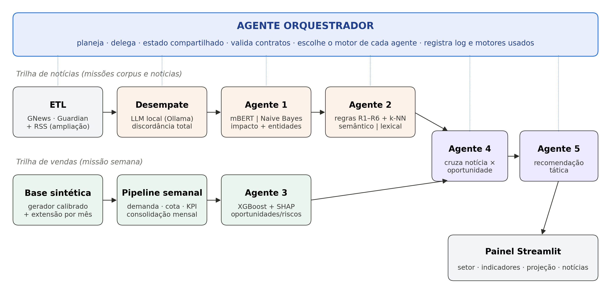

# Sistema de Recomendações para o Mercado Farmacêutico de Diabetes Usando Agentes de IA

Trabalho de Conclusão de Curso em Ciência da Computação — Faculdade de Computação e Informática, Universidade Presbiteriana Mackenzie (2026).

Sistema de inteligência prescritiva com arquitetura multiagente. Ele cruza **notícias do setor**, **indicadores de mercado** e **desempenho da força de vendas** no mercado de medicamentos para diabetes (inibidores de SGLT2) e gera **recomendações táticas por setor comercial**, cada uma rastreável até a notícia, a regra e o agente que a produziram.

O trabalho está documentado em duas versões:

- [`docs/artigo/Artigo_Completo_TCC.docx`](docs/artigo/Artigo_Completo_TCC.docx) — versão completa, com a metodologia detalhada (base sintética, cada agente, fundamentação dos cálculos) e todos os resultados;
- [`docs/artigo/Artigo_Final_TCC.docx`](docs/artigo/Artigo_Final_TCC.docx) — versão condensada de 20 páginas entregue à banca.



---

## Arquitetura

Um **Agente Orquestrador** (padrão orquestrador–executor, em Python puro) coordena seis agentes especializados em duas trilhas que convergem nos Agentes 4 e 5:

| Agente                        | Função                                                                                          | Motor principal                | Motor substituto        |
| ----------------------------- | ------------------------------------------------------------------------------------------------- | ------------------------------ | ----------------------- |
| Orquestrador                  | ordena as missões, valida contratos, registra o motor usado e um log de cada decisão            | —                             | —                      |
| Desempate                     | resolve notícias com discordância total entre os três avaliadores                              | Llama 3.1 local (Ollama)       | revisão manual         |
| 1 · Classificador de Impacto | classifica o impacto da notícia (Alto, Médio, Baixo)                                            | mBERT (ajuste fino, exige GPU) | Naive Bayes multinomial |
| 2 · Validador e Ajuste       | recalibra a confiança com k-NN semântico e aplica regras de negócio R1–R6                     | sentence-transformers          | TF-IDF com hashing      |
| 3 · Oportunidades de Mercado | prevê a participação de mercado do mês seguinte e gera oportunidades e riscos                 | XGBoost + SHAP                 | regressão ridge        |
| 4 · Riscos e Oportunidades   | liga cada notícia aprovada às oportunidades afetadas, com score rastreável                     | regras auditáveis             | —                      |
| 5 · Recomendações          | escolhe as quatro notícias de maior impacto por setor e redige ação, justificativa e urgência | modelo de linguagem (opcional) | modelos de texto        |

O motor efetivamente usado em cada execução fica registrado em `data/orquestrador/estado.json`.

## Principais resultados

| Componente      | Resultado                                                                                                                                            |
| --------------- | ---------------------------------------------------------------------------------------------------------------------------------------------------- |
| Corpus          | 1.415 notícias anotadas por três avaliadores (κ de Fleiss = 0,1858); ampliado para 1.410 notícias, 1.275 com classe consolidada (425 por classe) |
| Agente 1        | F1-macro de 0,796 com mBERT (avaliado à parte, com GPU) e 0,728 com Naive Bayes (validação cruzada de 5 partições, fora da amostra)             |
| Agente 2        | 94,8% das notícias de alto impacto preservadas; precisão da aprovação de 0,860                                                                   |
| Base sintética | índice de fidelidade de 98,27 em 100, calibrada apenas em parâmetros agregados                                                                     |
| Agente 3        | MAE 7,6% menor que a persistência (teste temporal); acerto de direção de 47,4%                                                                    |
| Agentes 4 e 5   | 4.020 achados em 26 setores, 92,7% ancorados em regra de sensibilidade                                                                               |

As 310 notícias adicionadas na ampliação foram classificadas de forma automatizada a partir de um guia de regras (`docs/Arquitetura/ampliar_corpus_noticias.py`); a concordância dessas classificações (κ = 0,7539) reflete o protocolo, e não avaliadores humanos independentes. As limitações completas estão na seção 4.8 do artigo.

---

## Estrutura do repositório

```
app/                    painel Streamlit (app/painel.py)
scripts/                pontos de entrada: base sintética, pipeline semanal, orquestrador, métricas
src/
  agentes/              orquestrador, Desempate e Agentes 1 a 5, motores substitutos
  data/                 extração e carga das notícias (GNews e The Guardian)
  noticias/             pipeline de notícias usado pelo painel
  painel/               camada de dados e ações do painel
  sintetico/            gerador calibrado, calendário, cota, KPIs, validação e carga
  estatistica_kappa/    cálculo de Kappa de Cohen e de Fleiss
tests/                  testes automatizados (pytest)
data/
  calibracao/           parâmetros agregados da base de referência (calibracao.json)
  estatistica_kappa/    corpus anotado e corpus ampliado
  agentes/              saídas e métricas dos agentes
  config/               mapa de entidades das notícias
  noticias/, orquestrador/   estado da última execução
docs/
  artigo/               artigo final, figuras e script que gera as figuras
  Arquitetura/          guias de execução, métricas, painel e relatório de validação
```

Saídas grandes e regeneráveis (`data/sintetico/*.csv`, `data/semanal/`, `data/painel/`, `logs/`) não são versionadas; os scripts abaixo as recriam.

---

## Instalação

Requisitos: Python 3.11 ou superior (o `requirements.txt` fixa o pandas 3.x).

```bash
git clone https://github.com/MarcosArambasic/sistema-recomendacao-comercial-industria-farmaceutica.git
cd sistema-recomendacao-comercial-industria-farmaceutica
python -m venv venv
source venv/bin/activate          # Windows: venv\Scripts\activate
pip install -r requirements.txt
cp .env.example .env              # e preencha as chaves que for usar
```

Dependências opcionais, só para os motores principais:

```bash
pip install torch transformers            # Agente 1 com mBERT (treino exige GPU)
pip install sentence-transformers         # Agente 2 com encoder semântico (~1 GB de modelo)
ollama pull llama3.1                      # Desempate com modelo local (https://ollama.com)
```

Sem elas, o orquestrador usa automaticamente os motores substitutos e registra essa escolha.

## Reprodução dos resultados

A sequência abaixo reproduz os números do artigo (Apêndice A):

```bash
python scripts/gerar_base_inicial.py                      # base sintética mensal
python scripts/gerar_backfill_semanal.py                  # histórico semanal
python scripts/gerar_kpi_final.py                         # base de treino do Agente 3
python -m src.agentes.agente3_oportunidades_mercado       # Agente 3
python scripts/orquestrar.py corpus                       # Desempate e Agentes 1 e 2
python scripts/orquestrar.py noticias                     # notícias e Agentes 4 e 5
python scripts/avaliar_agentes.py                         # métricas consolidadas
streamlit run app/painel.py                               # painel de insights
```

O que cada etapa exige:

| Etapa                                             | Requisito                                                                                                |
| ------------------------------------------------- | -------------------------------------------------------------------------------------------------------- |
| Base sintética, Agente 3, Naive Bayes, métricas | apenas CPU; sem chaves de API                                                                            |
| Treino do mBERT                                   | GPU (sem ela, o orquestrador usa o Naive Bayes)                                                          |
| Desempate com LLM                                 | Ollama em execução com `llama3.1` (sem ele, os casos vão para revisão manual)                      |
| Coleta de notícias novas                         | chaves GNews e/ou The Guardian no `.env` (ou `python scripts/orquestrar.py noticias --sem-extracao`) |
| Redação com LLM no Agente 5                     | `OPENAI_API_KEY` e `--usar-llm` (opcional)                                                           |

O corpus anotado (`data/estatistica_kappa/`) e os parâmetros de calibração (`data/calibracao/calibracao.json`) são arquivos previamente gerados e já estão no repositório. A geração da base é determinística por semente.

Outros comandos úteis:

```bash
python scripts/orquestrar.py status       # motores disponíveis e última execução
python scripts/orquestrar.py semana       # próxima semana comercial + Agentes 3, 4 e 5
python scripts/testar_desempate.py        # verifica o Desempate com o modelo local
pytest tests/                             # testes automatizados
```

O guia operacional detalhado do pipeline semanal está em [`docs/Arquitetura/COMO_RODAR_O_PIPELINE.md`](docs/Arquitetura/COMO_RODAR_O_PIPELINE.md), e as definições das métricas em [`docs/Arquitetura/METRICAS_AGENTES.md`](docs/Arquitetura/METRICAS_AGENTES.md).

## Painel

```bash
streamlit run app/painel.py
```

Por setor comercial, o painel mostra cinco indicadores mês a mês, a projeção semanal frente à cota, as recomendações do Agente 3 e as quatro notícias de maior impacto com a justificativa de cada recomendação. Os botões **Gerar nova semana** e **Gerar mais notícias** disparam as missões `semana` e `noticias` do orquestrador. Mais detalhes em [`docs/Arquitetura/PAINEL_STREAMLIT.md`](docs/Arquitetura/PAINEL_STREAMLIT.md).

## Dados e confidencialidade

Os dados comerciais de referência pertencem a uma empresa do setor e não estão neste repositório. Na empresa foram executadas apenas consultas de agregação (demanda e participação mensais por UF); somente esses parâmetros agregados saíram e estão em `data/calibracao/calibracao.json`. Todos os registros de vendas, produtos e pontos de venda deste repositório são **sintéticos**, e o vínculo entre moléculas reais e produtos sintéticos é hipotético. As recomendações demonstram o mecanismo e não devem ser usadas como decisões comerciais reais.

---

## Autores

- Guilherme Gomes Arantes Teles
- Marcos Arambasic Rebelo da Silva
- Matheus Alonso Varjão

Orientador: Prof. Ivan Carlos Alcantra de Oliveira

## Como citar

> TELES, Guilherme Gomes Arantes; SILVA, Marcos Arambasic Rebelo da; VARJÃO, Matheus Alonso. **Sistema de Recomendações para o Mercado Farmacêutico de Diabetes Usando Agentes de IA**. 2026. Trabalho de Conclusão de Curso (Bacharelado em Ciência da Computação) – Faculdade de Computação e Informática, Universidade Presbiteriana Mackenzie, São Paulo, 2026.
